  

  
  
  

---

## 🧙 FICHA DO PERSONAGEM

| Atributo | Valor |
|---|---|
| 🏷️ Nome | Kaike Alves Praxedes |
| ⚔️ Classe | Dev em formação (ADS) |
| 🗺️ Missão atual | Entrar na área de dados |
| 🎯 Especialidade | PCP, planilhas, ERP e análise de dados |
| 🕹️ Hobbies | Games, criação de jogos 2D, modelagem e animação |

---

## 🛠️ SKILLS (Linguagens e ferramentas)

| Skill | Nível de XP |
|---|---|
| 🐍 Python | ████████░░ 80% |
| ☕ Java | ███████░░░ 70% |
| 🧩 C | ██████░░░░ 60% |
| 🌐 HTML/CSS | ██████░░░░ 60% |
| 🗃️ SQL | █████░░░░░ 50% |

  
  
  
  
  
  

---

## 🏆 CONQUISTAS DESBLOQUEADAS

- ✅ Certificado de Power BI
- ✅ Certificado de Soluções de IA no GitHub
- ✅ Participou da ExpoCIEE 2026
- ✅ Criou o primeiro perfil no GitHub
- 🔒 Primeiro projeto de dados (em andamento)

---

## 📜 QUESTS (Projetos)

| Quest | Status |
|---|---|
| 🧮 Algoritmos de ordenação em C | ✅ Completa |
| 🏭 Sistema ERP | ⏳ Em andamento |
| 🌐 Meu site em HTML | ⏳ Em andamento |

---

## 📊 STATUS DO GITHUB

  
  

---

## 📫 CONTATO

<i>🎮 Press START to collaborate!</i>

